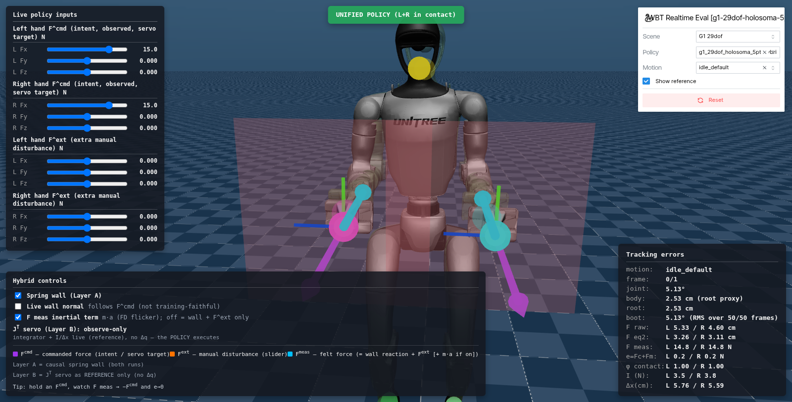

<p align="center">
  
</p>

# FLoRe: Learning Force-Reactive Humanoid Loco-Manipulation

**Anonymous Authors** · under review

[[Project Page]](https://sites.google.com/view/icra2027-flore)
[[Paper]] *(coming soon)*
[[Video]](https://sites.google.com/view/icra2027-flore)

FLoRe learns **force-reactive humanoid loco-manipulation from robot-free demonstrations**. A UMI-style
handheld interface records hand and torso motion together with the contact wrench the operator applies.
A **force-reactive diffusion policy** observes wrist images, robot state and the measured wrench at each
hand, and predicts keypoint motion *and* per-hand force commands. A **unified force–position whole-body
controller** executes both on a Unitree G1 while keeping balance, with real force/torque feedback in the
loop.

This repository holds the code for both levels. The first release covers the **low-level controller**:
training it in Isaac Lab and testing it interactively in the browser (MuJoCo compiled to WebAssembly).

# News

- **2026-09-28** — Initial code release: training of the 5-keypoint unified force–position whole-body
  controller, and its interactive browser evaluation (mjswan). The source of the high-level
  force-reactive diffusion policy (`fuji/`) is included; its guides, the datasets and the checkpoints will
  follow.

# Release Plan

- [x] Low-level controller: 5-keypoint unified force–position whole-body controller, training (Isaac Lab)
- [x] Low-level controller: interactive browser evaluation with live force commands (mjswan, MuJoCo WebAssembly)
- [x] High-level policy: source code of the force-reactive diffusion policy (`fuji/`)
- [ ] High-level policy: training and deployment guide
- [ ] Pretrained checkpoints (low-level ONNX, high-level policies)
- [ ] Robot-free data collection interface and datasets
- [ ] Real-robot deployment on the Unitree G1

# Content Table

- [Repository Structure](#repository-structure)
- [Installation](#installation)
- [Usage](#usage)
  - [1. Prepare motion data](#1-prepare-motion-data)
  - [2. Train the 5-keypoint controller](#2-train-the-5-keypoint-controller)
  - [3. Evaluate it in the browser (mjswan)](#3-evaluate-it-in-the-browser-mjswan)
  - [4. Run the tests](#4-run-the-tests)
- [Citation](#citation)
- [Acknowledgments](#acknowledgments)
- [License](#license)

# Repository Structure

```
FLoRe/
├── third_party/
│   ├── holosoma_extensions/            # LOW LEVEL: unified force–position whole-body controller
│   │   ├── scripts/                    #   environment setup (Isaac Sim / Isaac Lab) + browser-eval installer
│   │   ├── src/extensions/wbt_wrappers/
│   │   │   ├── wbt_training/           #   training presets, force model, rewards, launchers (Isaac Lab)
│   │   │   ├── wbt_realtime_eval/      #   ONNX policy -> in-browser MuJoCo bundle with the force UI
│   │   │   └── wbt_wrappers_inference/ #   policy wrappers and inference utilities
│   │   └── thirdparty/holosoma/        #   holosoma, the training framework (git submodule)
│   └── mjswan/                         # MuJoCo + ONNX Runtime in the browser (WebAssembly)
├── fuji/                               # HIGH LEVEL: force-reactive diffusion policy (data, models, serving)
├── scripts/                            #   training / offline inference / online planner entry points
├── tests/                              #   CPU-only unit tests of fuji/
├── configs/
└── assets/
```

# Installation

The two levels live in two environments: the low-level controller uses a conda environment with
Isaac Sim (Python 3.11), the high-level policy a `uv` virtual environment (Python 3.12). Usage steps 1–3
below only need the first one.

**Prerequisites.** Linux x86-64 (tested on Ubuntu 24.04 with an RTX 5090, driver 580), an NVIDIA GPU with
a driver that supports [Isaac Sim 5.1](https://docs.isaacsim.omniverse.nvidia.com/latest/installation/requirements.html),
about 40 GB of free disk, and `git`, `curl`, `cmake`, `build-essential` and GNU `patch`:

```bash
sudo apt update && sudo apt install -y git curl cmake build-essential patch
```

**1**. Clone the repository with its submodule:

```bash
git clone --recursive https://github.com/Louis-Leee/FLoRe.git
cd FLoRe
# already cloned without --recursive?
git submodule update --init --recursive
```

**2**. Create the low-level controller environment `hssim` (Isaac Sim 5.1 + Isaac Lab 2.3):

```bash
bash third_party/holosoma_extensions/scripts/setup_isaacsim.sh
source third_party/holosoma_extensions/scripts/source_isaacsim_setup.sh    # activates hssim
pip install -e third_party/holosoma_extensions/src/extensions/wbt_wrappers/wbt_training
```

`setup_isaacsim.sh` installs Miniconda into `~/.holosoma_deps/miniconda3` if needed, creates the conda
environment (Python 3.11, PyTorch 2.7 + CUDA 12.8, Isaac Sim 5.1, Isaac Lab v2.3 in
`~/.holosoma_deps/IsaacLab`) and installs holosoma in editable mode. The first run downloads roughly 15 GB
and takes 30–60 minutes depending on bandwidth; the environment itself takes about 25 GB. It also runs
`sudo apt install cmake build-essential`, so it may ask for your password. Set `ENV_NAME=<name>` on every
command of this README to use another environment name, and activate the environment in every new shell
with the `source ... source_isaacsim_setup.sh` line above.

**3**. Add the browser evaluation stack to the same environment:

```bash
bash third_party/holosoma_extensions/scripts/_install_viz_stack.sh
```

This installs `mjswan` (vendored in `third_party/mjswan`), `wbt_realtime_eval`, `holosoma_inference` and
`nodeenv`. The first bundle build downloads its own Node.js 25.5 into mjswan's template directory, so no
system Node.js is needed.

**4** *(optional, high-level policy)*. Create the `uv` environment and run the CPU-only unit tests:

```bash
curl -LsSf https://astral.sh/uv/install.sh | sh     # if uv is not installed yet
uv sync --locked --extra dev
uv run --extra dev pytest -ra
```

# Usage

All commands below run inside the `hssim` environment, from `third_party/holosoma_extensions`:

```bash
source third_party/holosoma_extensions/scripts/source_isaacsim_setup.sh
cd third_party/holosoma_extensions
RUNS=src/extensions/wbt_wrappers/wbt_training/training_runs
```

### 1. Prepare motion data

The controller tracks whole-body motion clips in holosoma's NPZ format for the 29-DoF G1: `fps`,
`joint_pos` `(T, 7+29)` (root position, root quaternion wxyz, joints), `joint_vel` `(T, 6+29)`,
`body_pos_w`, `body_quat_w`, `body_lin_vel_w`, `body_ang_vel_w` `(T, B, ·)`, `body_names` and
`joint_names`. Put your clips in one directory; every clip in it must use the same `body_names`.
Converters for common sources are in `$RUNS`: `csv_to_holosoma_npz.py` (retargeted CSV, e.g. LAFAN1),
`pkl_to_holosoma_npz.py`, `beyondmimic_to_holosoma_npz.py`, then `fix_holosoma_npz_fk.py` and
`merge_motions.py`.

The paper's controller was trained on a large set of retargeted manipulation and locomotion clips.
For a quick smoke test, holosoma ships a demo clip:

```bash
mkdir -p ~/flore_motions
cp thirdparty/holosoma/src/holosoma/holosoma/data/motions/g1_29dof/whole_body_tracking/sub3_largebox_003_mj.npz ~/flore_motions/
```

### 2. Train the 5-keypoint controller

The controller tracks five keypoints in the pelvis frame (both hand TCPs, the torso and both feet) and a
commanded force at each hand. During training every hand meets a simulated compliant wall with a
simulated wrist F/T sensor, and the commanded force shifts the hand target through a contact-gated
integrator of the force error (paper Sec. III-A).

```bash
MOTION_DIR=$HOME/flore_motions bash $RUNS/train_hybrid_unified_5pt_dense_8gpu.sh
```

| Variable / flag | Default | Meaning |
| --- | --- | --- |
| `MOTION_DIR` | — | directory of holosoma NPZ clips (step 1) |
| `NGPUS`, `NUM_ENVS` | `8`, `32768` | GPUs (one `torchrun` process each) and total parallel environments |
| `EXP` | `exp:g1-wbt-5pt-hybrid-unified-anneal` | the 5-keypoint preset; `exp:g1-wbt-hybrid-unified-anneal` trains the dense 29-joint twin |
| `WBT_HAND_MASS_DR` | `0` | `1` = phase 2: randomize the gripper mass (and the matching sensor model) |
| `WANDB_ENTITY`, `WANDB_PROJECT` | your default, `FLoRe` | Weights & Biases logging |
| `--logger.mode offline` | — | append to train without a W&B account |

Any extra argument is forwarded to `wbt_training.train_agent` (tyro, last value wins), e.g.
`--algo.config.num-learning-iterations 20000` or `--algo.config.save-interval 500`. A single-GPU run, and
a three-iteration smoke test that checks the whole setup in a few minutes:

```bash
NGPUS=1 NUM_ENVS=4096 MOTION_DIR=$HOME/flore_motions bash $RUNS/train_hybrid_unified_5pt_dense_8gpu.sh

NGPUS=1 NUM_ENVS=64 MOTION_DIR=$HOME/flore_motions bash $RUNS/train_hybrid_unified_5pt_dense_8gpu.sh \
    --logger.mode offline --algo.config.num-learning-iterations 3 --algo.config.save-interval 1
```

Checkpoints and their ONNX exports are written to `logs/WBT-Holosoma/<run>/model_<step>.{pt,onnx}`.

### 3. Evaluate it in the browser (mjswan)

The trained ONNX policy runs **in your browser**: physics (MuJoCo) and inference (ONNX Runtime) are
compiled to WebAssembly, so the page is a static site that needs no GPU and no Python while it runs.
The browser twin reproduces the training force model: a virtual spring wall per hand, the simulated F/T
reading, the contact phase and the integrator.

```bash
MODEL=$PWD/logs/WBT-Holosoma/<run>/model_<step>.onnx SRC=$HOME/flore_motions \
    bash $RUNS/run_hybrid_5pt_unified_anneal_realtime_viz.sh
```

then open <http://localhost:8012> (from a remote machine: `ssh -L 8012:localhost:8012 <host>`). Leaving
`MODEL` unset picks the newest `model_*.onnx` under `logs/WBT-Holosoma`. `SRC` is any directory of
holosoma clips; `NO_LAUNCH=1` only builds the bundle and `PORT=` changes the port. The server listens on
all network interfaces; the bundle in `dist/` is a static site and can be hosted anywhere.

<p align="center">
  
</p>

What the page shows:

- **Motion** (top right) selects the reference clip — `idle_default` (standing still, added automatically)
  or one of yours — played as a translucent ghost next to the live robot; the five tracking points are
  drawn on both.
- **Live policy inputs** (top left) set the commanded force F<sup>cmd</sup> of each hand (x, y, z, up to
  25 N) and an extra external disturbance F<sup>ext</sup>.
- **Hybrid controls** (bottom left) toggle the spring wall in front of each hand, a wall whose normal
  follows F<sup>cmd</sup>, and the inertial term of the simulated F/T reading.
- **Tracking errors** (bottom right) reads out the tracking errors, the measured force F<sup>meas</sup>, the
  force error e = F<sup>cmd</sup> + F<sup>meas</sup>, the contact phase φ, the integrator I and the resulting
  hand-target shift Δx. Arrows: purple F<sup>cmd</sup>, orange F<sup>ext</sup>, cyan F<sup>meas</sup>.

Hold an F<sup>cmd</sup> and watch F<sup>meas</sup> converge to −F<sup>cmd</sup> (e → 0) while the robot keeps
balance; the badge at the top turns green once a hand is in contact.

The same two steps by hand:

```bash
wbt-realtime-eval-patch-mjswan          # idempotent; a no-op on the vendored mjswan
MUJOCO_GL=egl wbt-realtime-eval --preset g1-29dof-holosoma-5pt-hybrid-unified-anneal-wbt \
    --model-path /abs/path/model_<step>.onnx --motion-dir $HOME/flore_motions \
    --output-dir dist/flore_5pt --show-control-point --no-launch
wbt-realtime-eval-serve dist/flore_5pt --host 127.0.0.1 --port 8012
```

### 4. Run the tests

```bash
# low level (hssim environment, from third_party/holosoma_extensions)
python -m pytest -q src/extensions/wbt_wrappers/wbt_training/tests \
    src/extensions/wbt_wrappers/wbt_realtime_eval/tests src/extensions/wbt_wrappers/wbt_wrappers_inference/tests

# high level (uv environment, from the repository root)
uv run --extra dev pytest -ra
```

Tests that need hardware, recorded data or components that are not released yet skip themselves.

# Citation

If you find this work useful, please cite:

```bibtex
@misc{flore2026,
  title  = {{FLoRe}: Learning Force-Reactive Humanoid Loco-Manipulation},
  author = {Anonymous Authors},
  year   = {2026},
  note   = {Under review}
}
```

# Acknowledgments

The low-level controller is built on [holosoma](https://github.com/amazon-far/holosoma) and trained in
[Isaac Lab](https://github.com/isaac-sim/IsaacLab) / Isaac Sim. The browser evaluation runs on
[mjswan](https://github.com/ttktjmt/mjswan) (MuJoCo WebAssembly + ONNX Runtime Web), vendored here with
a hybrid force-control runtime. The handheld interface and policy recipe follow
[UMI](https://github.com/real-stanford/universal_manipulation_interface) and
[Diffusion Policy](https://github.com/real-stanford/diffusion_policy). We thank the authors of these
projects for releasing their code.

# License

The code in this repository is released under the [Apache License 2.0](LICENSE). Third-party components
keep their own licenses: holosoma (Apache-2.0, git submodule) and mjswan (Apache-2.0, modified copy in
`third_party/mjswan`, see its `LICENSE`).
