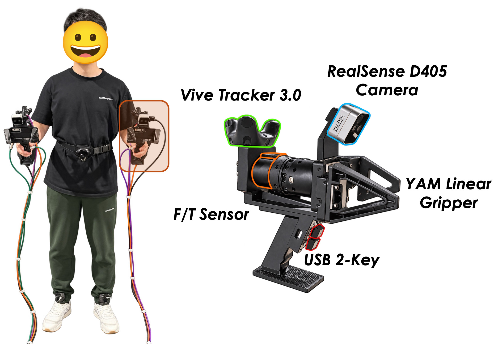

<p align="center">
  <picture>
    <source media="(prefers-color-scheme: dark)" srcset="assets/title_dark.png">
    
  </picture>
</p>

<h3 align="center">Learning Force-Reactive Humanoid Loco-Manipulation</h3>

<p align="center">
  <a href="https://scholar.google.com/citations?user=90IoeJsAAAAJ">Sihang Li</a><sup>1,2§</sup>,
  <a href="https://scholar.google.com/citations?user=XGBg7wEAAAAJ">Xiaofeng Guo</a><sup>1</sup>,
  <a href="https://scholar.google.com/citations?user=xDtTbmQAAAAJ">Jinkun Cao</a><sup>1</sup>,
  <a href="https://charlietcheng.github.io/">Charlie Cheng</a><sup>1</sup>,<br>
  <a href="https://scholar.google.com/citations?user=b-o1o7cAAAAJ">Ruihan Yang</a><sup>1</sup>,
  <a href="https://scholar.google.com/citations?user=YeG8ZM0AAAAJ">Chen Feng</a><sup>1,2†</sup>,
  <a href="https://scholar.google.com/citations?user=joR1Z4UAAAAJ">Guanya Shi</a><sup>1,3†</sup>,
  <a href="https://scholar.google.com/citations?user=iyVHKkcAAAAJ">Haozhi Qi</a><sup>1,4†</sup>
</p>

<p align="center">
  <sup>1</sup>Amazon FAR (Frontier AI &amp; Robotics) &nbsp;&nbsp; <sup>2</sup>New York University<br>
  <sup>3</sup>Carnegie Mellon University &nbsp;&nbsp; <sup>4</sup>University of Chicago
</p>

<p align="center">
  <sup>§</sup>Work done while interning at Amazon FAR &nbsp;&nbsp; <sup>†</sup>Amazon FAR team co-lead
</p>

<p align="center">
  <a href="https://louis-leee.github.io/FLoRe">🌐 Project Page</a> &nbsp;|&nbsp;
  <a href="assets/FLoRe.pdf">📄 Paper</a> &nbsp;|&nbsp;
  <a href="https://louis-leee.github.io/FLoRe/#video">🎬 Video</a> &nbsp;|&nbsp;
  <a href="https://louis-leee.github.io/FLoRe/demo/">🎮 Demo</a>
</p>

FLoRe learns **force-reactive humanoid loco-manipulation from robot-free demonstrations**. A UMI-style
handheld interface records hand and torso motion together with the contact wrench the operator applies.
A **force-reactive diffusion policy** observes wrist images, robot state and the measured wrench at each
hand, and predicts keypoint motion *and* per-hand force commands. A **unified force–position whole-body
controller** executes both on a Unitree G1 while keeping balance, with real force/torque feedback in the
loop.

This repository holds the code for both levels. Released so far: the **low-level controller** (its
training in Isaac Lab, its interactive test in the browser with MuJoCo compiled to WebAssembly, the
pretrained checkpoint, and its deployment on a Unitree G1) and the hardware of the **robot-free data
collection interface**.

# 📰 News

- **2026-10-19** — Release of the paper, the pretrained low-level controller (ONNX) with its real-robot
  deployment on the Unitree G1, and the 3D-printable parts of the robot-free data collection interface.
- **2026-09-28** — Initial code release: training of the 5-keypoint unified force–position whole-body
  controller, and its interactive browser evaluation (mjswan). The source of the high-level
  force-reactive diffusion policy (`flore/`) is included; its guide will follow.

# ✅ Release Plan

- [x] Low-level controller: 5-keypoint unified force–position whole-body controller, training (Isaac Lab)
- [x] Low-level controller: interactive browser evaluation with live force commands (mjswan, MuJoCo WebAssembly)
- [x] High-level policy: source code of the force-reactive diffusion policy (`flore/`)
- [x] Pretrained low-level controller (ONNX)
- [x] Robot-free data collection interface (3D-printable parts)
- [x] Real-robot deployment on the Unitree G1
- [ ] High-level policy: training and deployment guide

# 📑 Content Table

- [🌳 Repository Structure](#-repository-structure)
- [📦 Installation](#-installation)
- [🚀 Usage](#-usage)
  - [1. Prepare motion data](#1-prepare-motion-data)
  - [2. Train the 5-keypoint controller](#2-train-the-5-keypoint-controller)
  - [3. Evaluate it in the browser (mjswan)](#3-evaluate-it-in-the-browser-mjswan)
  - [4. Run the tests](#4-run-the-tests)
- [🧠 Pretrained Low-level Controller](#-pretrained-low-level-controller)
- [✋ Robot-free Data Collection Interface](#-robot-free-data-collection-interface)
- [🤖 Real-robot Deployment on the Unitree G1](#-real-robot-deployment-on-the-unitree-g1)
  - [1. Set up the robot (once)](#1-set-up-the-robot-once)
  - [2. Run the low-level controller](#2-run-the-low-level-controller)
  - [Without F/T sensors: a pure position controller](#without-ft-sensors-a-pure-position-controller)
- [📝 Citation](#-citation)
- [🙏 Acknowledgments](#-acknowledgments)
- [📜 License](#-license)

# 🌳 Repository Structure

```
FLoRe/
├── third_party/
│   ├── holosoma_extensions/            # LOW LEVEL: unified force–position whole-body controller
│   │   ├── scripts/                    #   environment setup (Isaac Sim / Isaac Lab) + browser-eval installer
│   │   ├── force_deploy/               #   real-robot deployment: F/T bridge, controller launcher, onboard rig
│   │   ├── src/extensions/wbt_wrappers/
│   │   │   ├── wbt_training/           #   training presets, force model, rewards, launchers (Isaac Lab)
│   │   │   ├── wbt_realtime_eval/      #   ONNX policy -> in-browser MuJoCo bundle with the force UI
│   │   │   └── wbt_wrappers_inference/ #   policy wrappers and inference utilities
│   │   └── thirdparty/holosoma/        #   holosoma, the training framework (git submodule)
│   └── mjswan/                         # MuJoCo + ONNX Runtime in the browser (WebAssembly)
├── flore/                              # HIGH LEVEL: force-reactive diffusion policy (data, models, serving)
├── scripts/                            #   training / offline inference / online planner entry points
├── tests/                              #   CPU-only unit tests of flore/
├── configs/
├── assets/                             # the paper (FLoRe.pdf) and the figures of this README
└── UMI_Hardware.zip                    # 3D-printable parts of the data collection interface (STL)
```

# 📦 Installation

The two levels live in two environments: the low-level controller uses a conda environment with
Isaac Sim (Python 3.11), the high-level policy a `uv` virtual environment (Python 3.12). Usage steps 1–3
below only need the first one; the [real-robot deployment](#-real-robot-deployment-on-the-unitree-g1)
builds its own environments on the robot.

**Prerequisites.** Linux x86-64 (tested on Ubuntu 24.04 with an RTX 5090, driver 580), an NVIDIA GPU with
a driver that supports [Isaac Sim 5.1](https://docs.isaacsim.omniverse.nvidia.com/latest/installation/requirements.html),
about 40 GB of free disk, and `git`, `curl`, `cmake`, `build-essential` and GNU `patch`:

```bash
sudo apt update && sudo apt install -y git curl cmake build-essential patch
```

**1**. Clone the repository with its submodule:

```bash
git clone --recursive https://github.com/Louis-Leee/FLoRe.git
cd FLoRe
# already cloned without --recursive?
git submodule update --init --recursive
```

**2**. Create the low-level controller environment `hssim` (Isaac Sim 5.1 + Isaac Lab 2.3):

```bash
bash third_party/holosoma_extensions/scripts/setup_isaacsim.sh
source third_party/holosoma_extensions/scripts/source_isaacsim_setup.sh    # activates hssim
pip install -e third_party/holosoma_extensions/src/extensions/wbt_wrappers/wbt_training
```

`setup_isaacsim.sh` installs Miniconda into `~/.holosoma_deps/miniconda3` if needed, creates the conda
environment (Python 3.11, PyTorch 2.7 + CUDA 12.8, Isaac Sim 5.1, Isaac Lab v2.3 in
`~/.holosoma_deps/IsaacLab`) and installs holosoma in editable mode. The first run downloads roughly 15 GB
and takes 30–60 minutes depending on bandwidth; the environment itself takes about 25 GB. It also runs
`sudo apt install cmake build-essential`, so it may ask for your password. Set `ENV_NAME=<name>` on every
command of this README to use another environment name, and activate the environment in every new shell
with the `source ... source_isaacsim_setup.sh` line above.

**3**. Add the browser evaluation stack to the same environment:

```bash
bash third_party/holosoma_extensions/scripts/_install_viz_stack.sh
```

This installs `mjswan` (vendored in `third_party/mjswan`), `wbt_realtime_eval`, `holosoma_inference` and
`nodeenv`. The first bundle build downloads its own Node.js 25.5 into mjswan's template directory, so no
system Node.js is needed.

**4** *(optional, high-level policy)*. Create the `uv` environment and run the CPU-only unit tests:

```bash
curl -LsSf https://astral.sh/uv/install.sh | sh     # if uv is not installed yet
uv sync --locked --extra dev
uv run --extra dev pytest -ra
```

# 🚀 Usage

All commands below run inside the `hssim` environment, from `third_party/holosoma_extensions`:

```bash
source third_party/holosoma_extensions/scripts/source_isaacsim_setup.sh
cd third_party/holosoma_extensions
RUNS=src/extensions/wbt_wrappers/wbt_training/training_runs
```

### 1. Prepare motion data

The controller tracks whole-body motion clips in holosoma's NPZ format for the 29-DoF G1: `fps`,
`joint_pos` `(T, 7+29)` (root position, root quaternion wxyz, joints), `joint_vel` `(T, 6+29)`,
`body_pos_w`, `body_quat_w`, `body_lin_vel_w`, `body_ang_vel_w` `(T, B, ·)`, `body_names` and
`joint_names`. Put your clips in one directory; every clip in it must use the same `body_names`.
Converters for common sources are in `$RUNS`: `csv_to_holosoma_npz.py` (retargeted CSV, e.g. LAFAN1),
`pkl_to_holosoma_npz.py`, `beyondmimic_to_holosoma_npz.py`, then `fix_holosoma_npz_fk.py` and
`merge_motions.py`.

The paper's controller was trained on a large set of retargeted manipulation and locomotion clips.
For a quick smoke test, holosoma ships a demo clip:

```bash
mkdir -p ~/flore_motions
cp thirdparty/holosoma/src/holosoma/holosoma/data/motions/g1_29dof/whole_body_tracking/sub3_largebox_003_mj.npz ~/flore_motions/
```

### 2. Train the 5-keypoint controller

The controller tracks five keypoints in the pelvis frame (both hand TCPs, the torso and both feet) and a
commanded force at each hand. During training every hand meets a simulated compliant wall with a
simulated wrist F/T sensor, and the commanded force shifts the hand target through a contact-gated
integrator of the force error (paper Sec. III-A).

```bash
MOTION_DIR=$HOME/flore_motions bash $RUNS/train_hybrid_unified_5pt_dense_8gpu.sh
```

| Variable / flag | Default | Meaning |
| --- | --- | --- |
| `MOTION_DIR` | — | directory of holosoma NPZ clips (step 1) |
| `NGPUS`, `NUM_ENVS` | `8`, `32768` | GPUs (one `torchrun` process each) and total parallel environments |
| `EXP` | `exp:g1-wbt-5pt-hybrid-unified-anneal` | the 5-keypoint preset; `exp:g1-wbt-hybrid-unified-anneal` trains the dense 29-joint twin |
| `WBT_HAND_MASS_DR` | `0` | `1` = phase 2: randomize the gripper mass (and the matching sensor model) |
| `WANDB_ENTITY`, `WANDB_PROJECT` | your default, `FLoRe` | Weights & Biases logging |
| `--logger.mode offline` | — | append to train without a W&B account |

Any extra argument is forwarded to `wbt_training.train_agent` (tyro, last value wins), e.g.
`--algo.config.num-learning-iterations 20000` or `--algo.config.save-interval 500`. A single-GPU run, and
a three-iteration smoke test that checks the whole setup in a few minutes:

```bash
NGPUS=1 NUM_ENVS=4096 MOTION_DIR=$HOME/flore_motions bash $RUNS/train_hybrid_unified_5pt_dense_8gpu.sh

NGPUS=1 NUM_ENVS=64 MOTION_DIR=$HOME/flore_motions bash $RUNS/train_hybrid_unified_5pt_dense_8gpu.sh \
    --logger.mode offline --algo.config.num-learning-iterations 3 --algo.config.save-interval 1
```

Checkpoints and their ONNX exports are written to `logs/WBT-Holosoma/<run>/model_<step>.{pt,onnx}`.

### 3. Evaluate it in the browser (mjswan)

The trained ONNX policy runs **in your browser**: physics (MuJoCo) and inference (ONNX Runtime) are
compiled to WebAssembly, so the page is a static site that needs no GPU and no Python while it runs.
The browser twin reproduces the training force model: a virtual spring wall per hand, the simulated F/T
reading, the contact phase and the integrator. To try it without installing anything, open the
[interactive demo](https://louis-leee.github.io/FLoRe/demo/) on the project page.

```bash
MODEL=$PWD/logs/WBT-Holosoma/<run>/model_<step>.onnx SRC=$HOME/flore_motions \
    bash $RUNS/run_hybrid_5pt_unified_anneal_realtime_viz.sh
```

then open <http://localhost:8012> (from a remote machine: `ssh -L 8012:localhost:8012 <host>`). Leaving
`MODEL` unset picks the newest `model_*.onnx` under `logs/WBT-Holosoma`. `SRC` is any directory of
holosoma clips; `NO_LAUNCH=1` only builds the bundle and `PORT=` changes the port. The server listens on
all network interfaces; the bundle in `dist/` is a static site and can be hosted anywhere.

<p align="center">
  
</p>

What the page shows:

- **Motion** (top right) selects the reference clip — `idle_default` (standing still, added automatically)
  or one of yours — played as a translucent ghost next to the live robot; the five tracking points are
  drawn on both.
- **Live policy inputs** (top left) set the commanded force F<sup>cmd</sup> of each hand (x, y, z, up to
  25 N) and an extra external disturbance F<sup>ext</sup>.
- **Hybrid controls** (bottom left) toggle the spring wall in front of each hand, a wall whose normal
  follows F<sup>cmd</sup>, and the inertial term of the simulated F/T reading.
- **Tracking errors** (bottom right) reads out the tracking errors, the measured force F<sup>meas</sup>, the
  force error e = F<sup>cmd</sup> + F<sup>meas</sup>, the contact phase φ, the integrator I and the resulting
  hand-target shift Δx. Arrows: purple F<sup>cmd</sup>, orange F<sup>ext</sup>, cyan F<sup>meas</sup>.

Hold an F<sup>cmd</sup> and watch F<sup>meas</sup> converge to −F<sup>cmd</sup> (e → 0) while the robot keeps
balance; the badge at the top turns green once a hand is in contact.

The same two steps by hand:

```bash
wbt-realtime-eval-patch-mjswan          # idempotent; a no-op on the vendored mjswan
MUJOCO_GL=egl wbt-realtime-eval --preset g1-29dof-holosoma-5pt-hybrid-unified-anneal-wbt \
    --model-path /abs/path/model_<step>.onnx --motion-dir $HOME/flore_motions \
    --output-dir dist/flore_5pt --show-control-point --no-launch
wbt-realtime-eval-serve dist/flore_5pt --host 127.0.0.1 --port 8012
```

### 4. Run the tests

```bash
# low level (hssim environment, from third_party/holosoma_extensions)
python -m pytest -q src/extensions/wbt_wrappers/wbt_training/tests \
    src/extensions/wbt_wrappers/wbt_realtime_eval/tests src/extensions/wbt_wrappers/wbt_wrappers_inference/tests

# high level (uv environment, from the repository root)
uv run --extra dev pytest -ra
```

Tests that need hardware, recorded data or components that are not released yet skip themselves.

# 🧠 Pretrained Low-level Controller

The paper's 5-keypoint controller is released as one ONNX file,
**[model_62999.onnx](https://drive.google.com/file/d/1WVoo7euWALbFvuLMN2xwqTBEpFhCfEn5/view?usp=drive_link)**
(952 MB, sha256 `45fef74ce6b97fd62dc7b4fc27aaa0f7b2355ff94cdd7d2c8e3427dcae5bd449`): the final export of
training run `pq9shxs7` for the preset `g1-29dof-holosoma-5pt-hybrid-unified-anneal-wbt`, and the
controller that the [real-robot deployment](#-real-robot-deployment-on-the-unitree-g1) runs. Put it where
the deployment looks for it:

```bash
cd third_party/holosoma_extensions
mkdir -p logs/WBT-Holosoma/pq9shxs7
mv ~/Downloads/model_62999.onnx logs/WBT-Holosoma/pq9shxs7/
sha256sum logs/WBT-Holosoma/pq9shxs7/model_62999.onnx     # 45fef74c...
```

It runs in the browser too, through [step 3](#3-evaluate-it-in-the-browser-mjswan) of Usage (the build
strips the motion tables baked into the export, leaving a 39 MB policy):

```bash
MODEL=$PWD/logs/WBT-Holosoma/pq9shxs7/model_62999.onnx SRC=$HOME/flore_motions \
    bash $RUNS/run_hybrid_5pt_unified_anneal_realtime_viz.sh
```

Without F/T sensors it runs as a pure position controller
([below](#without-ft-sensors-a-pure-position-controller)).

# ✋ Robot-free Data Collection Interface

<p align="center">
  
</p>

Two handheld UMI-style grippers, each carrying a 6-axis F/T sensor, and three trackers record hand and
torso motion, gripper width and contact force – with no robot in the loop. Each gripper holds a
[Bota Systems](https://botasys.com/force-torque-sensors/rokubi/) F/T sensor between the handle and a YAM
linear gripper, a RealSense D405 wrist camera, a Vive Tracker 3.0 and a USB 2-key. The robot carries the
same gripper–sensor assembly on each wrist, so the sensor frame, the sensor-to-TCP transform and the
gripper geometry are the same in collection and deployment.

[`UMI_Hardware.zip`](UMI_Hardware.zip) holds the 3D-printable parts, as STL files in `ForceUMI/`: the
pistol grip (`Pistol+yam.stl`), the RealSense D405 bracket (`yam_realsense.stl`), the back plate and the
flanges that join the handle, the F/T sensor and the YAM gripper (`yam_back.stl`, `yam_umi.stl`,
`yam_ft.stl`), and `G1 Adapter.stl`, which mounts the gripper–sensor assembly on the G1's wrist.
`G1 Adapter.stl`, `yam_ft.stl` and `yam_umi.stl` are in meters and the other three in millimeters, so
scale those three by 1000 in your slicer.

# 🤖 Real-robot Deployment on the Unitree G1

The low-level controller runs **on the robot**: the G1's onboard Jetson Orin NX runs the F/T bridge and
the controller in a Docker container, and the workstation keeps the high-level policy, which needs its
GPU. SSH tunnels keep every socket on `127.0.0.1` on both machines. The scripts are in
`third_party/holosoma_extensions/force_deploy/`:

| Script | Runs on | Role |
| --- | --- | --- |
| `onboard/g1_tunnel.sh` | workstation | SSH tunnels. Robot → workstation: F/T `:8771`, RecordTap `:8779`, cameras and grippers; workstation → robot: the high-level command stream `:8770` |
| `2_ft_bridge.sh` | robot | both F/T sensors → WebSocket `:8771`, payload-compensated, tared and low-passed at 12 Hz |
| `3_run_policy_vive_force.sh` | robot | the low-level controller at 50 Hz on the robot's DDS; refuses a checkpoint that does not match `MODE` before it touches the robot |
| `onboard/rig.sh` | robot | runs one command in the onboard container (linked as `~/flore_rig/rig.sh`) |
| `onboard/sync_to_g1.sh` | workstation | copies the code and the checkpoint to the robot (`~/flore_rig/home`) |
| `onboard/Dockerfile`, `onboard/setup_envs.sh`, `onboard/g1_internet.sh` | robot, workstation | the image and its environments, and a proxy that gives the robot internet access to build them |

**Hardware.** A Unitree G1 (29 DoF) with the gripper–sensor assembly of the
[data collection interface](#-robot-free-data-collection-interface) on each wrist (`G1 Adapter.stl`), the
F/T sensors plugged into its Jetson, and one Ethernet cable to the workstation, which sits on the robot's
network (e.g. `192.168.123.224/24`). The commands below reach the Jetson (`unitree@192.168.123.164`) as
`g1`: add a `Host g1` entry with that address to `~/.ssh/config`, copy your key (`ssh-copy-id g1`), and
add `unitree` to the Jetson's `docker` group.

### 1. Set up the robot (once)

On the workstation, from `third_party/holosoma_extensions/force_deploy`:

1. Download the checkpoint into `../logs/WBT-Holosoma/pq9shxs7/`
   ([above](#-pretrained-low-level-controller)).
2. Put your F/T sensors' configs into `bota_config/` (see below), then copy everything to the robot:
   ```bash
   bash onboard/sync_to_g1.sh
   ```
3. Load the image's base onto the robot and give it internet access (the last command stays open):
   ```bash
   docker pull --platform linux/arm64 ubuntu:24.04
   docker save --platform linux/arm64 ubuntu:24.04 | ssh g1 docker load
   bash onboard/g1_internet.sh
   ```
4. On the robot (`ssh g1`), build the image and the environments:
   ```bash
   cd ~/flore_rig/home/FLoRe/third_party/holosoma_extensions/force_deploy/onboard
   docker build --network host --build-arg http_proxy=http://127.0.0.1:3128 \
       --build-arg https_proxy=http://127.0.0.1:3128 -t flore-rig:latest .
   http_proxy=http://127.0.0.1:3128 https_proxy=http://127.0.0.1:3128 \
       ~/flore_rig/rig.sh bash onboard/setup_envs.sh
   ```

`setup_envs.sh` installs, at the versions of the paper's rig, the F/T bridge's environment
(`force_deploy/.venv-bota`: Python 3.12 and the Bota toolkit) and the controller's runtime
(`~/.holosoma_deps/miniconda3/envs/hssim`: Python 3.11, ONNX Runtime, Pinocchio and the Unitree SDK). Both
live in the container's home, `~/flore_rig/home` on the robot, so they survive new images and new syncs.
Re-run `sync_to_g1.sh` after every code change; it refuses while a rig command is running.

**F/T sensor configs.** `2_ft_bridge.sh` reads the Bota driver config and each tool's payload (mass,
center of mass, inertia) from `force_deploy/bota_config/`. They describe your own sensors and grippers,
so the release ships none:

```
bota_config/
├── bota_driver/bota_binary.json
├── bota_payload_utils/payload_compensator_{left,right}.json
└── rnea_dynamic_compensator/rnea_compensator_{left,right}.json
```

The payload compensators serve `FT_ALGO=bota` (gravity only), the RNEA ones the default `FT_ALGO=rnea`
(gravity and inertia). Each hand finds its sensor by serial number: pass `LEFT_SERIAL=` and
`RIGHT_SERIAL=` (a substring of the sensor's name in `/dev/serial/by-id`) before `bash 2_ft_bridge.sh`.

### 2. Run the low-level controller

Hang the robot on its gantry, turn it on, and put it in damping mode and then development mode (`L2+R2`
on the remote), as in
[holosoma's real-robot guide](https://github.com/Louis-Leee/holosoma/blob/975463c97f7396aba77adb02a3c1cb8ddf44ceb1/src/holosoma_inference/docs/workflows/real-robot-wbt.md).
Then, in one terminal each on the workstation, from `third_party/holosoma_extensions/force_deploy`:

```bash
# workstation: the tunnels (keep it open)
bash onboard/g1_tunnel.sh

# robot: both F/T sensors -> :8771
ssh -t g1 flore_rig/rig.sh bash 2_ft_bridge.sh --pipeline

# robot: the low-level controller
ssh -t g1 flore_rig/rig.sh MODE=5pt-unified-anneal HOLOSOMA_VIVE_RELATIVE=0 FORCE_HANDS=both \
    FORCE_ESTOP_N=200 RECORD=1 FORCE_CMD_WIRE=1 bash 3_run_policy_vive_force.sh
```

Write `flore_rig/rig.sh`, not `~/flore_rig/rig.sh`: the workstation's shell would expand `~` to its own
home before ssh sends the command. `--pipeline` adds the 6-axis wrench that the high-level policy
observes to the bridge's stream. The controller's settings:

| Setting | Meaning |
| --- | --- |
| `MODE=5pt-unified-anneal` | the 5-keypoint controller (preset `g1-29dof-holosoma-5pt-hybrid-unified-anneal-wbt`), loaded from `logs/WBT-Holosoma/pq9shxs7/`; `ONNX=/abs/path.onnx` loads another export |
| `HOLOSOMA_VIVE_RELATIVE=0` | absolute targets: the keypoints on `:8770` are the hand, torso and foot targets in the pelvis frame, as the high-level policy publishes them |
| `FORCE_CMD_WIRE=1` | executes each hand's force command from `:8770`, zeroing those under 1.5 N; `0`, the default, ignores them |
| `FORCE_HANDS=both` | the hands whose F/T sensor is in the loop: `both`, `left`, `right` or `none` (default `left` with absolute targets) |
| `FORCE_ESTOP_N=200` | hard stop: a measured force above this (N) stops the controller as `B` does (default 40, `0` = off) |
| `RECORD=1` | streams the robot's measured state on `:8779` (RecordTap), which the high-level policy reads back |

The keypoint targets and force commands come from the high-level policy, `scripts/run_hl_serving_5pt.sh`
on the workstation (its guide follows with the high-level release). Until you arm the controller it
holds its ready pose. Drive it from the remote, or from the keyboard in its terminal:

| Remote | Keyboard | Action |
| --- | --- | --- |
| `A` | `]` | start: the robot goes to its ready pose and holds it; the F/T sensors are tared, so keep the grippers in free space |
| `start` | `=` | arm or disarm: the keypoints follow `:8770` (arming is refused while they are far from the robot's pose) |
| `B` | `o` | stop: stiff hold where the robot is, disarmed, force commands zeroed; re-home with `Y` (`i`), then `A` again |
| `R2` | `T` | re-tare both F/T sensors, in free space |
| `L1+R1` | – | kill the controller |

The hard stop stops the policy, not the motors: keep the robot on the gantry and a hand on the hardware
E-stop for first runs. To rehearse a launch without moving the robot, add
`PY=/home/rig/FLoRe/third_party/holosoma_extensions/force_deploy/onboard/py_dryrun.sh` to the command:
every check runs, and the final `run_policy` command is printed instead of executed.

### Without F/T sensors: a pure position controller

The low-level controller also runs **without force sensors**, as a pure position controller that tracks
the five keypoints. Skip the F/T bridge and start the controller with `FORCE_HANDS=none`:

```bash
ssh -t g1 flore_rig/rig.sh MODE=5pt-unified-anneal HOLOSOMA_VIVE_RELATIVE=0 FORCE_HANDS=none \
    RECORD=1 FORCE_CMD_WIRE=1 bash 3_run_policy_vive_force.sh
```

Both hands' force readings are then zeroed at the source (no measured force, contact phase, integral or
hard stop), their force commands from `:8770` are dropped, and with `FORCE_CMD_WIRE=1` the keyboard's
force keys are off too. The controller keeps polling for the bridge on `:8771` and logs a reconnect
warning every few seconds, which is harmless.

# 📝 Citation

If you find this work useful, please cite:

```bibtex
@misc{flore2026,
  title  = {{FLoRe}: Learning Force-Reactive Humanoid Loco-Manipulation},
  author = {Li, Sihang and Guo, Xiaofeng and Cao, Jinkun and Cheng, Charlie and Yang, Ruihan and
            Feng, Chen and Shi, Guanya and Qi, Haozhi},
  year   = {2026},
  note   = {Under review}
}
```

# 🙏 Acknowledgments

The low-level controller is built on [holosoma](https://github.com/amazon-far/holosoma) and trained in
[Isaac Lab](https://github.com/isaac-sim/IsaacLab) / Isaac Sim. The browser evaluation runs on
[mjswan](https://github.com/ttktjmt/mjswan) (MuJoCo WebAssembly + ONNX Runtime Web), vendored here with
a hybrid force-control runtime. The handheld interface and policy recipe follow
[UMI](https://github.com/real-stanford/universal_manipulation_interface) and
[Diffusion Policy](https://github.com/real-stanford/diffusion_policy). We thank the authors of these
projects for releasing their code.

# 📜 License

The code in this repository is released under the [Apache License 2.0](LICENSE). Third-party components
keep their own licenses: holosoma (Apache-2.0, git submodule) and mjswan (Apache-2.0, modified copy in
`third_party/mjswan`, see its `LICENSE`).
